# Week 8 — Arduino Basics

<!-- Replace ## with the week number and Topic Name with the week's focus -->
<!-- You may also refer to each week's slide for the Topic Name -->
<!-- e.g. Week 03 — Arrays & Functions -->

---

### Activities

| Activity | What I Made                   |
| -------- | ----------------------------- |
| `8a`     | I teamed up with Isaac and Jacee to test out the on/off controls and fade control on Arduino. |
| `8b`     | We then went on to also test out the force sensor code on our setup. |

<!-- Add or remove rows to match the activities for this week. -->

---

### This Week

<!-- A short, informal summary of what you explored across the week's activities. What did you make? What clicked? What didn't?
     A few sentences is all you need — write it like a journal entry, not a report. -->

Just for clarification, for 8a, me, Isaac, and Jacee did type 2 and type 3, while for 8b, I believe we did type 2. But the extra code included is for my own reference, since Kapi said that the slides (and the code) could be changed around in the future. 

For 8a, we went through the basics of setting up the arduino using the solder-less bread board and some LEDs, resisters, and jumper wires. Then we controlled the light functions by making it blink with a delay, or fade in and out.

For 8b, we controlled an unltrasonic sensor that could detect distance, compute it in meters, and send the info back to us through the console log.

---

### Output

**8a**

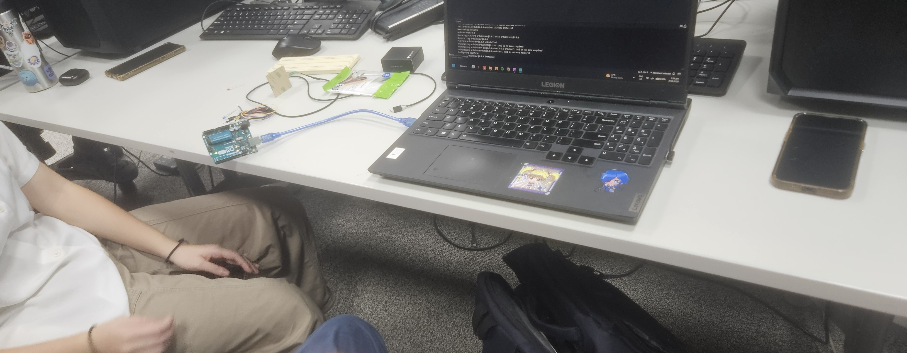

Here we began slowly setting up the arduino.

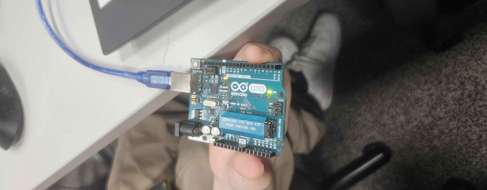

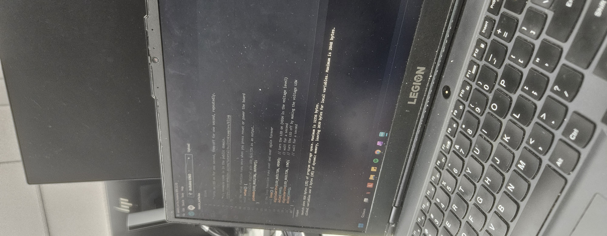

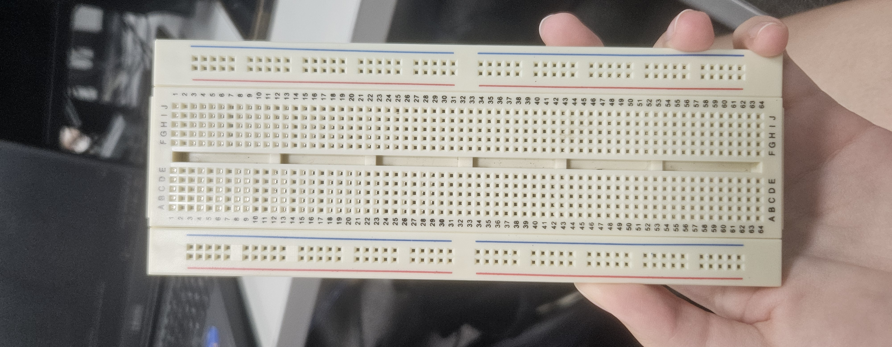

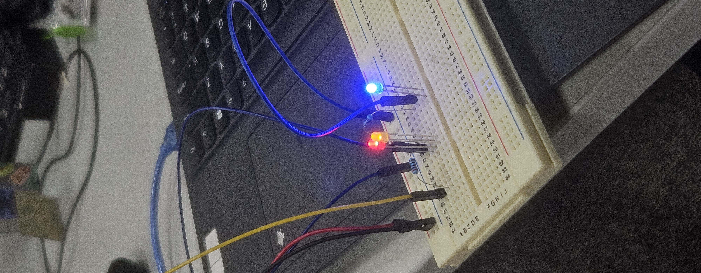

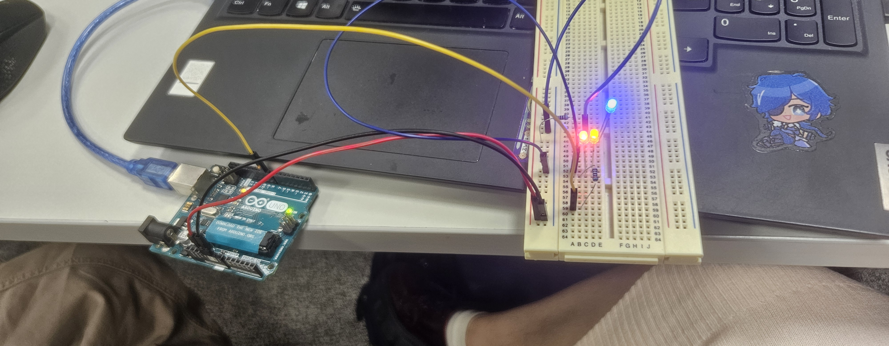

We got the lights working, but it was hard getting used to the new language used in Arduino.

[Blinking Light Example](https://youtube.com/shorts/iUQuHNehv5I) 


[Fading Light Example](https://youtube.com/shorts/rH6L4_IVb_Q?feature=share) 


---

**8b**

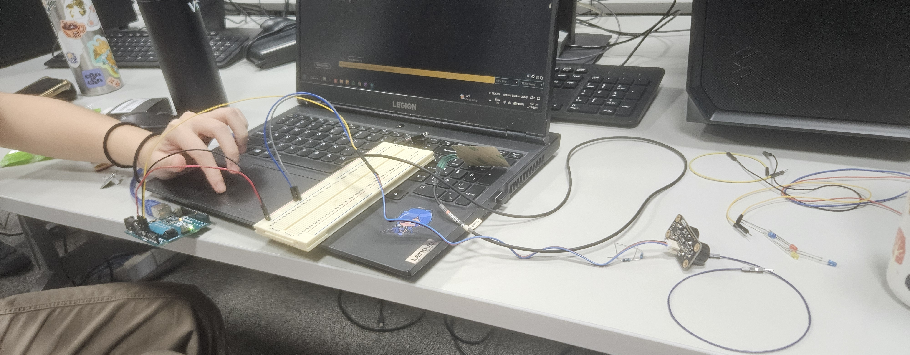

Slowly setting up the motion sensor...

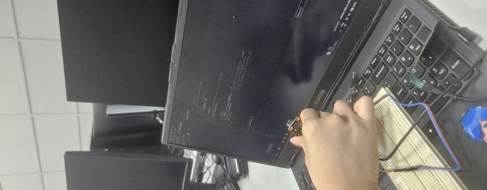

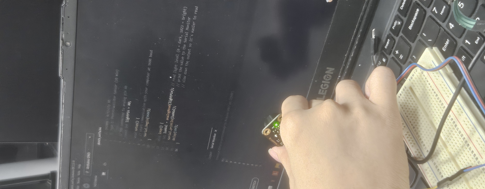

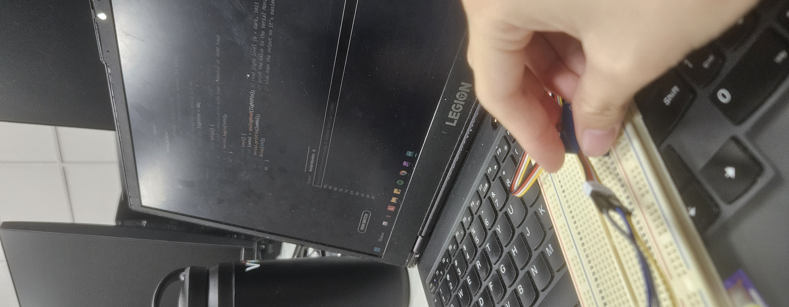

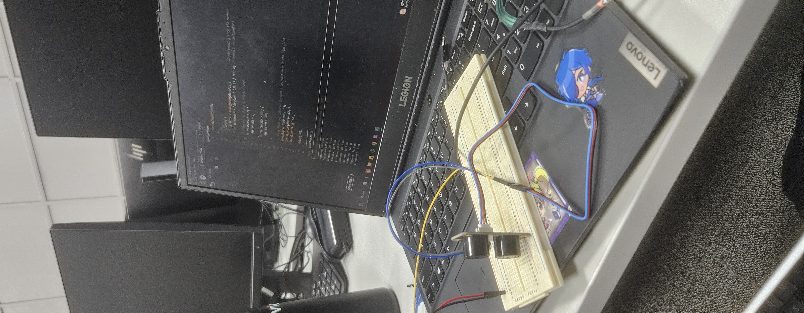

We got the console to convert the units to cm!

[Sensor Example](https://youtu.be/YYtU9IOrQGQ)


<!-- Drop a screenshot, photo, or GIF of something you made this week.
     Save it to a readme-assets/ folder inside this week's folder.
     Made more than one thing worth showing? Add more images. -->

---

<!-- ─────────────────────────────────────────────────────
     GOING FURTHER — if you want to document more, here are some ideas:

     ### 1a — Activity Name
     
     What you tried, what you discovered.

     ### 1b — Activity Name
     
     What you tried, what you discovered.

     ### 🧩 Something I Found Interesting
     A line of code, a technique, a happy accident — paste it here.
     ```js
     // your code here
     ```

     ### ❓ Questions I'm Sitting With
     Anything unresolved, something you want to revisit, or a rabbit hole you fell into.

     ### 🔗 References
     Links to anything that helped or inspired you this week.
     ───────────────────────────────────────────────────── -->
