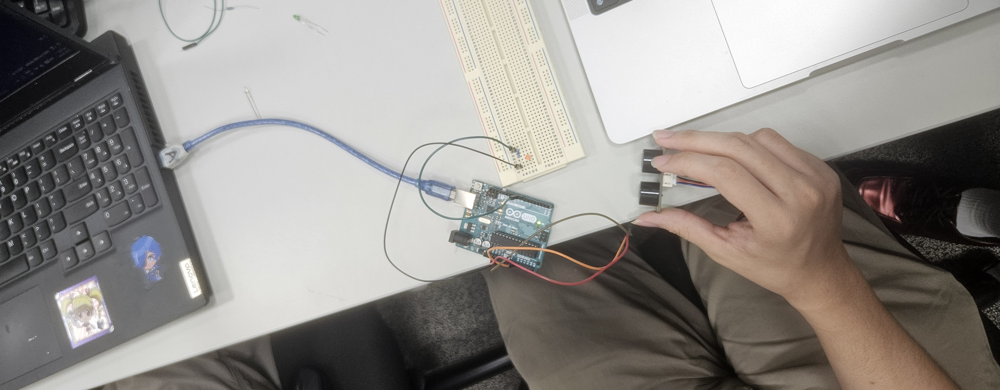

# Week 9 — Sensor to Screen

<!-- Replace ## with the week number and Topic Name with the week's focus -->
<!-- You may also refer to each week's slide for the Topic Name -->
<!-- e.g. Week 03 — Arrays & Functions -->

---

### Activities

| Activity | What I Made                   |
| -------- | ----------------------------- |
| `9a`     | Here, we tried making a sensor with an LED that got brighter as we got closer and dimmer as we got further away. |


<!-- Add or remove rows to match the activities for this week. -->

---

### This Week

<!-- A short, informal summary of what you explored across the week's activities. What did you make? What clicked? What didn't?
     A few sentences is all you need — write it like a journal entry, not a report. -->

     
Another week, another Arduino. Arduino was quite confusing for me, who had been used to coding in p5js for weeks. I'm not a coding expert either, so it was just like landing back at square one. We still managed to get the sensor working, with a little bit of help from Kapi. It helped that I was in a group, so we could come up with different ideas to overcome certain challenges.

---

### Output



Here's a progress video of us testing out the ultrasonic sensor in tandem with the light. Initially the light didn't work, so Kapi checked the code for us and let us know the data we received had to be mapped in 1-255 as that was the range of brightness the LED could put out. We were feeding extreme measurements to the light, which is why it either blinked brightly or not at all.

[Sensor Light Example](https://youtube.com/shorts/M3Vp37XRzP4)


<!-- Drop a screenshot, photo, or GIF of something you made this week.
     Save it to a readme-assets/ folder inside this week's folder.
     Made more than one thing worth showing? Add more images. -->

---

<!-- ─────────────────────────────────────────────────────
     GOING FURTHER — if you want to document more, here are some ideas:

     ### 1a — Activity Name
     
     What you tried, what you discovered.

     ### 1b — Activity Name
     
     What you tried, what you discovered.

     ### 🧩 Something I Found Interesting
     A line of code, a technique, a happy accident — paste it here.
     ```js
     // your code here
     ```

     ### ❓ Questions I'm Sitting With
     Anything unresolved, something you want to revisit, or a rabbit hole you fell into.

     ### 🔗 References
     Links to anything that helped or inspired you this week.
     ───────────────────────────────────────────────────── -->
